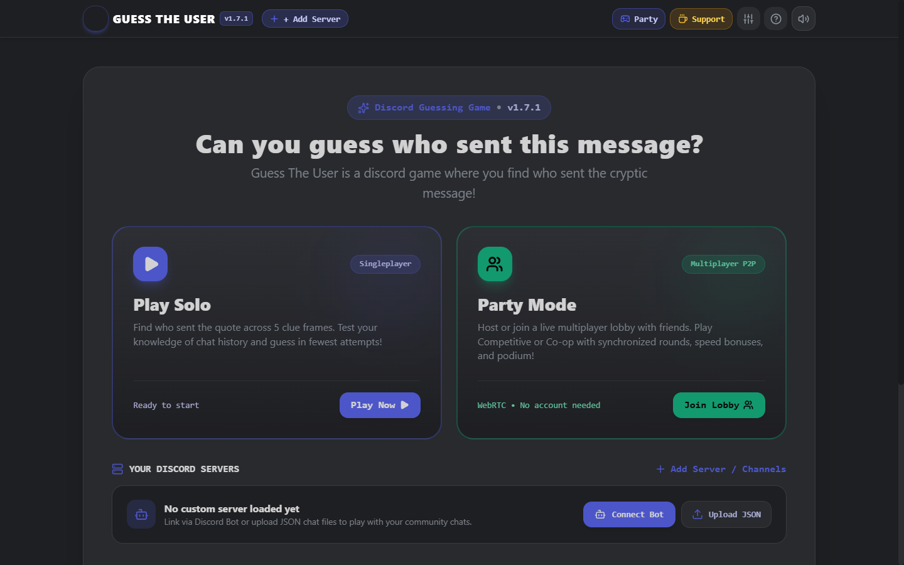
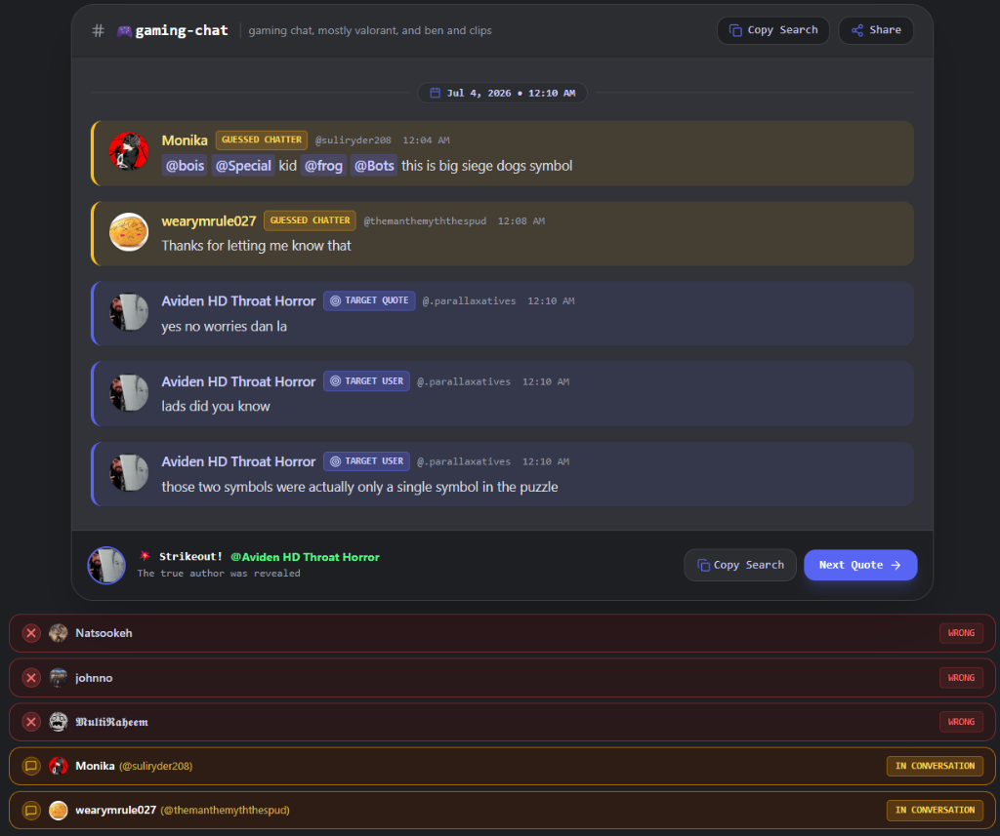
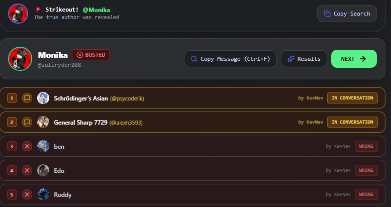
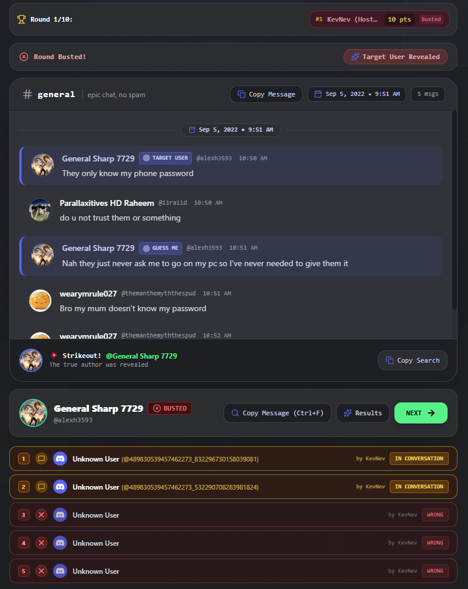
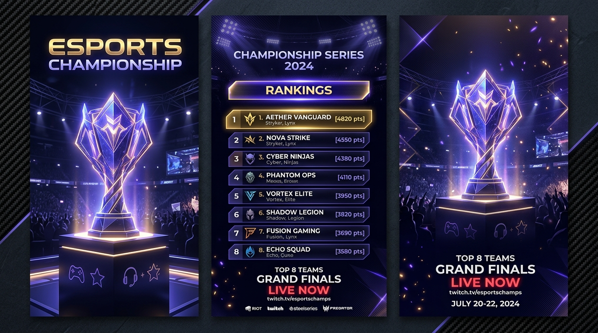
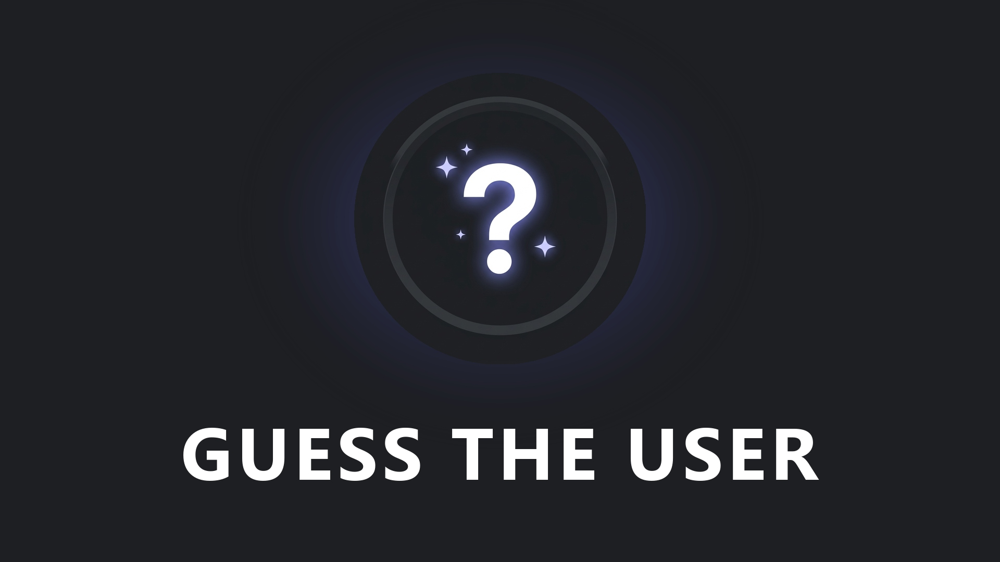

# 🎮 Guess The User

<p align="center">
  <strong>The out-of-context Discord trivia & deduction party game.</strong><br>
  <em>Playable directly in your browser or inside Discord Voice Channels as an Embedded Activity!</em>
</p>

<p align="center">
  <a href="https://guesstheuser.com"></a>
  <a href="https://discord.com/oauth2/authorize?client_id=1545362524751532082&permissions=68608&scope=bot%20applications.commands"></a>
  <a href="https://buymeacoffee.com/kevnev"></a>
</p>

<p align="center">
  
  
  
  
  
  
</p>

---

## 📌 Overview

**Guess The User** turns your server's hilarious, unhinged, and out-of-context quotes into a high-stakes deduction party game. 

Given an isolated message taken from your community's history, players have **5 progressive clue frames** to deduce which server member said it. Context clues gradually unmask neighboring conversation logs, timestamps, channel hints, and **Yellow Chatter** indicators.

You can play:
- **On the Web (`guesstheuser.com`):** Solo endless deduction or peer-to-peer multiplayer rooms.
- **Inside Discord:** Launch directly inside any Discord voice channel with friends—zero installations or downloads required!

---

## 📸 Screenshots Showcase

### 1. 🌐 The Web Application ([guesstheuser.com](https://guesstheuser.com))

| Interactive Landing & Server Selector | 5-Frame Deduction Gameplay |
| :---: | :---: |
|  |  |
| *Zero-friction startup with pre-bundled demo servers and custom challenge imports.* | *Progressive quote reveal, strike indicators, and avatar search filter.* |

---

### 2. 🎮 Discord Voice Channel Activity (Embedded App SDK)

Launch the game natively inside Discord voice chat with full support for Co-Op & Competitive party modes:

| Co-Op Party Deduction in Voice | Real-Time Compete Tournament |
| :---: | :---: |
|  |  |
| *Collaborate in voice chat to solve daily server challenges together.* | *Real-time tournament with synchronized countdown timers, scores, and early-skip guards.* |

| Activity Splash & Artwork | Cover Art |
| :---: | :---: |
|  |  |

---

## 🎯 Core Gameplay Mechanics

### 1. Progressive 5-Frame Scoring Matrix
Players earn points based on how few clues they need to guess the author:

| Frame | Clue Revealed | Max Score | Deduction Strategy |
| :---: | :--- | :---: | :--- |
| **Frame 1** | Target Quote (Clean text only) | **50 pts** | Identify distinct vocabulary, catchphrases, or inside jokes. |
| **Frame 2** | Preceding message unmasked | **40 pts** | Notice who replied to whom or what prompted the comment. |
| **Frame 3** | Subsequent reply unmasked | **30 pts** | Track reactions, nicknames, or conversational tone. |
| **Frame 4** | Surrounding thread context | **20 pts** | Reveal topic shifts, banter, and conversation flow. |
| **Frame 5** | Full thread + Channel name hint | **10 pts** | Channel topic narrows down the candidate pool. |

### 2. "Yellow Chatter" Deductions
- **Blue Messages:** Messages authored by the mystery target user.
- **Yellow Messages:** Messages mentioning or reacting to the mystery user.
- **Grey Messages:** Background conversation noise from other server members.

### 3. Game Modes
- **Solo Practice / Daily Seed:** Endless random challenges with streaks and daily challenges.
- **Co-Op Party Mode:** Play with friends in voice chat where everyone shares clues and guesses together.
- **Compete Tournament:** Race against the clock! Each player guesses individually on their own board while the live scoreboard tracks attempts in real time.

---

## 🔒 Privacy & Architecture Highlights

Guess The User was engineered from day one with **Zero-Knowledge Privacy**:

- **100% Client-Side Processing:** No Discord messages, logs, or user IDs are stored on any backend database.
- **Local IndexedDB Cache:** Imported server archives remain isolated inside the player's local browser storage.
- **Transient Real-Time Multiplayer:** Multiplayer rooms synchronize state peer-to-peer via WebRTC (`PeerJS`), meaning game moves are directly exchanged between clients without central persistence.
- **GDPR & Discord Developer Compliance:** Instant deletion compliance and zero third-party commercial tracking ads.

```
┌────────────────────────────────────────────────────────┐
│                   GUESS THE USER                      │
├──────────────────────────┬─────────────────────────────┤
│      Web Client          │    Discord Voice Activity   │
│   (Cloudflare Pages)     │    (Embedded App SDK)       │
├──────────────────────────┴─────────────────────────────┤
│         Browser Engine / IndexedDB Local Cache         │
├──────────────────────────┬─────────────────────────────┤
│   PeerJS WebRTC Sync     │     Railway Companion Bot   │
│  (Ephemeral Multiplayer) │   (Token Auth & Activity)   │
└──────────────────────────┴─────────────────────────────┘
```

---

## 🛠️ Tech Stack

- **Frontend:** React 19, TypeScript, Vite, Tailwind CSS, Lucide Icons, Canvas Confetti
- **Networking & Real-Time:** PeerJS (WebRTC), Discord Embedded App SDK
- **Backend & Bot:** Node.js, Express, Discord.js v14, Railway
- **Deployment:** Cloudflare Pages (Frontend CDN) + Railway (Bot & WebSocket Signaling)
- **Audio:** Web Audio API procedural synthesis (custom Discord-themed chimes & countdown soundscapes)

---

## 📦 Repository & Project Status

> [!NOTE]  
> This repository serves as the **public showcase and documentation hub** for Guess The User. The production application code is currently maintained in a private repository while multiplayer scaling audits are completed.

- 🌐 **Live Website:** [guesstheuser.com](https://guesstheuser.com)
- 🤖 **Add Discord Bot:** [Bot Authorization & Activity Invite](https://discord.com/oauth2/authorize?client_id=1545362524751532082&permissions=68608&scope=bot%20applications.commands)
- 📖 **How to Play Guide:** [guesstheuser.com/how-to-play.html](https://guesstheuser.com/how-to-play.html)
- ☕ **Support the Creator:** [buymeacoffee.com/kevnev](https://buymeacoffee.com/kevnev)

---

## 📄 License

This showcase repository is released under the [MIT License](LICENSE).
Built with ❤️ for Discord communities by [Kevin](https://github.com/kevnevv).
